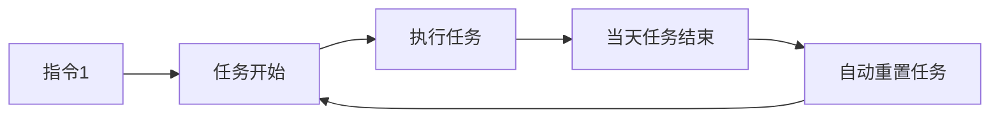
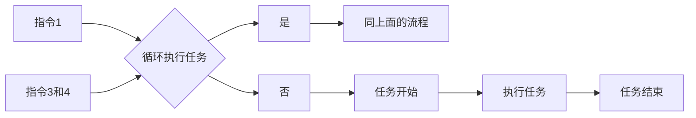

# DailyTask

> 基于 Kotlin 开发的 Android 无人值守打卡工具，兼容 Android 8 ~ 16 及 HarmonyOS 4.0。
> 其他系统需自行测试；Android 8 以下系统需修改 [lite/build.gradle](lite/build.gradle)
> 和 [app/build.gradle](app/build.gradle) 里面的 `minSdk`。

---

## 目录

- [软件介绍](#软件介绍)
- [重要限制](#重要限制)
- [最新版本](#最新版本)
- [版本更新日志](CHANGELOG.md)
- [快速开始](#快速开始)
- [远程指令](#远程指令)
- [远程中继](#远程中继)
- [通信机制](#通信机制)
- [打卡结果说明](#打卡结果说明)
- [常见问题与风险](#常见问题与风险)

---

## 软件介绍

| 序号 | 说明                                                          |
|:--:|:------------------------------------------------------------|
| 1  | 将一部备用手机置于公司工位，设置上下班打卡时间即可实现定时自动打卡。                          |
| 2  | 兼容 **Android 8.0 ~ 16.0** 以及 **HarmonyOS 4.0**；小米澎湃系统请自行测试。 |
| 3  | **无人值守方案**：不修改任何签到软件的内部逻辑，也不修改手机 GPS 位置。                    |
| 4  | 结果来源支持**通知监听**（钉钉）与**截屏服务**（适用于任何打卡应用）。                        |
| 5  | 支持**企业微信 Webhook** 与 **QQ 邮箱**两种消息通知渠道。                     |
| 6  | 支持 `DT#` 前缀的远程指令，用于控制任务执行、息屏、截屏、状态查询等。                      |
| 7  | 支持**每周固定**与**大小周**工作日设置，可按公司排班自动跳过休息日。                      |
| 8  | 支持**CloudBase 云端远程中继**和**微信小程序控制台**，不再依赖微信/QQ 后台接收指令。 |

### 重要限制

| 序号 | 说明                                                                                   |
|:--:|:-------------------------------------------------------------------------------------|
| 1  | **手机不可灭屏（手机开发者模式下，打开充电不息屏）**：灭屏状态下前台通知服务可能被系统回收，导致无法正常打卡。部分手机锁屏后再解锁不会直接进入桌面，同样会影响打卡。 |
| 2  | 按音量 **减小键** 可开启伪装灭屏模式（不影响打卡），再次按下退出；也可通过**上下滑动屏幕**手势切换。                              |
| 3  | 默认每日执行打卡任务，可通过 `DT#关闭循环` 指令远程暂停（需大号给小号发送指令，支持 QQ / 微信 / 支付宝 / TIM）。                  |
| 4  | 正式使用前建议先测试几天，确认稳定后再投入实际使用。                                                           |

---

## 最新版本

**2.4.2.2** — *2026年8月13日*

> 完整变更请查看 [版本更新日志 (CHANGELOG)](CHANGELOG.md)

---

## 快速开始

> **前提：目标打卡应用必须支持极速打卡，且已开启该功能。**

### 1. 权限配置

1. 打开 `DailyTask`，应用会自动检测悬浮窗权限，授权即可。
2. 进入手机 **设置 → 通知中心**，找到 `DailyTask`，开启通知权限。
3. 在 `DailyTask` 设置中选择**结果来源**：
    - `通知监听`（仅适用于钉钉）
    - `截屏服务`（理论上适用于任何打卡应用）
4. 开启**通知监听**权限（若未开启，开关底部会显示红色提示文字）。
5. 若钉钉无法监听到打卡结果，或使用飞书、企业微信等不产生打卡通知的应用，请**开启截屏服务**
   ，弹窗中选择「整个屏幕」即可。

### 2. 消息渠道配置

**企业微信**

1. 登录企业微信，创建群聊（可用小号），群聊成员必须都是企业微信用户，否则没有右上角的“设置”功能。
2. 进入群聊设置 → 消息推送 → 配置名称，复制 `webhook 地址` 并保存。
3. 将 `webhook 地址` 末尾的 key 值填入 `DailyTask` 的企业微信渠道配置中。

**QQ 邮箱**

- 填写发件箱地址、SMTP 授权码（**非邮箱密码**）及收件箱地址。
- 发件箱和收件箱可使用同一邮箱。

### 3. 远程中继（可选）

远程中继用于替代微信、QQ、TIM、支付宝通知作为控制通道。详细开发和配置说明见：

- [cloudfunctions/relay/README.md](cloudfunctions/relay/README.md)
- [miniprogram/README.md](miniprogram/README.md)

Android 端操作路径：

1. 进入 **设置 → 远程中继**。
2. 填写中继服务地址（生产环境为 `https://dailytaskapi.chaxc.com/relay`）。
3. 在微信小程序点击“添加设备”，生成 6 位配对码。
4. 将配对码和设备名称填入 Android，点击“保存并配对”。
5. 配对成功后，Android 会定时同步云端指令，并提供多重兜底，避免被系统省电策略限制。

#### 指令同步机制

远程指令的拉取有三重保障，任意一层存活即可收到指令：

| 层级 | 触发方式 | 说明 |
| --- | --- | --- |
| 1 | 前台服务内 60 秒轮询 | 最快，但国产 ROM（OPPO/ColorOS 等）可能杀死前台服务 |
| 2 | `AlarmManager` 每 15 分钟兜底唤醒 | 不依赖前台服务存活，是国产 ROM 上的主要保障 |
| 3 | `WorkManager` 15 分钟周期任务 | 系统级兜底，可能被进一步延迟 |

> 早期版本只有第 1 层和第 3 层，第 1 层被系统杀掉后仅靠 WorkManager，实际可能几十分钟才拉取一次指令；现已补充 `AlarmManager` 兜底。

#### 远程「立即打卡」行为

小程序点击【立即打卡】后，Android 会：

1. 打开目标应用（如钉钉）
2. 等待打卡成功通知，或等待超时（超时时间取「停留目标应用的时间」设置，默认 30 秒）
3. 回传结果到小程序：成功为 `打卡成功`，未收到成功通知为 `已打开目标应用，但 N 秒内未收到打卡成功通知`

该流程与定时任务共用同一套等待逻辑，结果会写入指令的 `resultMessage`，可在小程序设备页的「最近指令」中查看。

【启动任务】/【停止任务】执行后同样会通过已配置的消息渠道发送通知，与 `DT#` 聊天指令行为一致。
小程序只提供**远程快捷操作**：启动任务、停止任务、立即打卡、切换循环开关，以及设备状态和考勤记录查看。

> 任务时间、工作日（含大小周）等配置**由 Android 端本地管理**，不再通过云端下发，App 的「任务配置」「设置」页面仍是这些配置的唯一入口。

### 4. 验证

- 配置好消息渠道并开启截屏服务后，可使用「截屏测试」验证服务和消息渠道是否正常工作。
- 若需通过 QQ / TIM / 微信 / 支付宝唤起目标应用打卡，可使用「唤起测试」验证权限。

---

## 工作日设置

进入 **设置 → 任务配置 → 工作日设置**，可选择以下模式：

- **每周固定**：自定义每周固定工作日，默认周一至周五；未配置时保持原有行为。
- **大小周**：分别设置小周工作日和大周工作日，默认小周周一至周五、大周周一至周六。
- 首次启用大小周时，需要在弹出的单选框中选择“本周是小周”或“本周是大周”。应用以所选周为基准，之后按周自动交替。
- 法定节假日和国家调休补班日仍优先于工作日设置：补班日执行任务，法定节假日跳过任务。

工作日配置会随“导出配置”一并导出；导入旧版本配置时自动按“每周固定”处理。

---

## 远程指令

> 默认每日自动打卡，无需额外操作。以下指令用于远程控制任务执行。
>
> **指令格式**：所有远程指令必须以固定前缀 `DT#` 开头（例如 `DT#执行任务`），否则会被当作普通聊天消息忽略，避免日常对话误触发。

| 序号 | 指令        | 功能                         | 邮件通知 |
|:--:|:----------|:---------------------------|:----:|
| 1  | `DT#执行任务` | 启动循环任务（默认每天自动执行）           |  否   |
| 2  | `DT#终止任务` | 停止循环任务（仅停止当天）              |  否   |
| 3  | `DT#开启循环` | 开启循环标志位                    |  是   |
| 4  | `DT#关闭循环` | 关闭循环标志位（永久暂停，直到收到指令 3）     |  是   |
| 5  | `DT#息屏`   | 开启伪装灭屏模式                   |  否   |
| 6  | `DT#亮屏`   | 退出伪装灭屏模式                   |  否   |
| 7  | `DT#考勤记录` | 导出当天考勤记录                   |  是   |
| 8  | `DT#打卡`   | 触发一次打卡（默认指令文案为「打卡」）        |  否   |
| 9  | `DT#状态查询` | 查询当前状态（任务、服务、监听、电量、版本、日期等） |  是   |
| 10 | `DT#截屏`   | 截取目标应用屏幕并通过消息渠道返回          |  是   |

### 任务流程

**默认模式（每日自动打卡）：**

**循环控制模式（通过指令 1、3、4 控制任务日期）：**

---

## 远程中继

远程中继是可选功能。启用后，Android 会主动通过 HTTPS 访问 CloudBase 云函数：

- 拉取最新配置 revision。
- 拉取待执行指令。
- 执行后通过 `deviceAck` 回报结果。
- 上报电量、任务状态、通知监听状态和打卡记录。

微信小程序只负责写入配置和指令，不直接连接 Android。设备离线期间创建的指令会暂存在云端，指令过期后不会再执行。

### 支持的远程操作

| 操作 | 说明 |
|---|---|
| 启动任务 | 创建 `START_TASK`，设备同步后调用现有任务调度器 |
| 停止任务 | 创建 `STOP_TASK` |
| 立即打卡 | 创建 `TRIGGER_CLOCK_IN`，设备打开目标应用并等待通知结果 |
| 开启循环 | 更新云端 `autoRecycle=true` 配置 |
| 关闭循环 | 更新云端 `autoRecycle=false` 配置 |
| 查看考勤 | 查看设备上报的打卡通知记录 |
| 任务配置 | 同步任务时间、重置时间、目标应用、固定工作日和大小周 |
| 立即同步 | 设备或小程序可主动触发一次同步 |

### 可靠性设计

- Android 进程存活时，每 60 秒同步一次。
- WorkManager 每 15 分钟执行一次兜底同步。
- 网络恢复、开机、应用升级和应用打开后会触发同步。
- 指令带唯一 ID、有效期和 ACK。
- 配置按 revision 增量同步，断网恢复后自动追平。
- 邮箱授权码、企业微信 Webhook Key 仍保留在手机本地，不上传云端。
- 首次配对时出现的 `Cannot access database on the main thread` 已在当前开发版修复；使用最新构建的 APK 重新配对即可。

---
## 通信机制

---

## 打卡结果说明

|   结果   | 说明                                                                             |
|:------:|:-------------------------------------------------------------------------------|
| **成功** |                                                    |
| **失败** | 可能原因： 1. 账号被另一台设备挤下线 2. 未设置极速打卡 3. 应用打卡通知或手机通知被关闭 4. 当前设备登录了两个以上账号 |

---

## 常见问题与风险

### 可能被检测为作弊的情况

| 序号 | 原因                | 风险等级 |
|:--:|:------------------|:----:|
| 1  | 手机已 Root          |  极高  |
| 2  | 使用模拟定位软件修改打卡位置    |  极高  |
| 3  | 使用向日葵等远程控制软件      |  极高  |
| 4  | 使用 ADB 命令模拟手指点击打卡 |  极高  |
| 5  | 开启了无障碍服务          |  中等  |
| 6  | 手机通过数据线连接电脑       |  中等  |
6. 本地联调时可填写电脑局域网地址，例如 `http://192.168.x.x:8080/jeecg-boot/relay`；`http://` 与 `https://` 均被接受。
7. 不要填写 `localhost` 或 `127.0.0.1`，它们在真机上指向手机自身；局域网调试请确认电脑防火墙已放行 8080。
